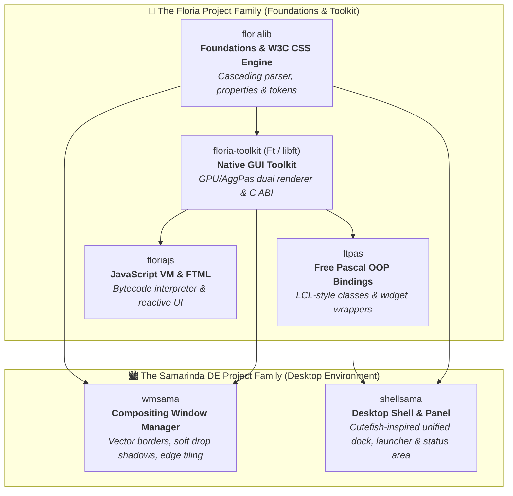

# Kirana Project

*What is this? I actually have absolutely no idea what I am doing. Previously, I was thinking of creating a DE with Free Pascal (called [Kirana](https://github.com/kirana-a2district/)). I thought it would be easier than using Qt, but that turned out to be way harder than expected, so I decided to build everything from scratch to make my life even more miserable. There's nothing interesting here, just another AI slop thingy or whatever. Treat it as a giant Object Pascal code snippet or whatever lol.*

---

## 🧭 Overview & Ecosystem Architecture

The **Kirana Project** is an ambitious, ground-up desktop ecosystem engineered in modern **Object Pascal / Free Pascal (FPC)** for native Linux (strictly **X11/XCB**). 

The ecosystem is divided into two distinct project families:
1. **The Floria Project Family** — The foundational libraries, graphics rendering pipeline, W3C CSS styling engine, universal C-ABI GUI toolkit, Pascal OOP bindings, and a custom JavaScript/FTML reactive runtime.
2. **The Samarinda DE Project Family** — The user-facing desktop environment, featuring a full-fledged vector-decorated compositing window manager and a native desktop shell with panels, launcher, and system tray.

---

## 🌸 The Floria Project Family

> **Why "Floria"?**  
> The name **Floria** pays tribute to **Florian Klämpfl**, the creator and lead architect of the Free Pascal Compiler. The short moniker for the toolkit is **`Ft`** (pronounced *"Feat"*).

The Floria family provides the complete technological substrate powering the entire desktop stack—from raw 2D vector mathematics and standards-compliant CSS styling to a high-level GUI toolkit and scripting runtime.

### 1. [`florialib`](https://github.com/kiranaproject/florialib) — Foundational Subsystems & W3C CSS Engine
The core foundational library for GUI toolkits, vector graphics, and window management in Object Pascal.
- **W3C CSS Styling & Cascading Engine (`Floria.CSS.*`)**: An end-to-end CSS Level 3 implementation written in Object Pascal. Includes a streaming push tokenizer (W3C CSS Syntax Level 3 §4), an AST with cascaded memory ownership, a parser (§5), typed CSS values (`TCSSColor` with hex, `rgb()`, `rgba()`, slash syntax, length units, and box borders), 70+ canonical properties, selector specificity calculation `(A, B, C)`, and right-to-left cascade resolution.
- **CSS Transitions & Custom Properties**: Built-in support for `:root` CSS variables (`var(--token)`), live theme swapping, and smooth state transitions with CSS easing functions (`ease`, `ease-in`, `ease-out`, `ease-in-out`, `linear`).
- **Core Abstractions**: Foundational collections, utility classes, and system primitives.

### 2. [`floria-toolkit` (`ft` / `libft.so`)](https://github.com/kiranaproject/ft) — Native Cross-Platform GUI Toolkit
A lightweight, high-performance native GUI toolkit engineered with Free Pascal, delivering 60 FPS transitions, rich widgets, and a universal C ABI.
- **Dual Rendering Pipeline**: 
  - **Hardware GPU Canvas**: High-performance **EGL / OpenGL ES 2.0** hardware pipeline (`TFtHardwareCanvas`, dynamic vertex batching, AOT shaders, SDF pills and drop shadows).
  - **Software Vector Fallback**: Mathematically rigorous **Anti-Grain Geometry (`AggPas`)** subpixel vector rasterization, guaranteeing pixel-perfect rendering across headless CI, virtual machines, and legacy hardware.
- **Universal C ABI (`libft.so`)**: Exports a clean foreign function interface (FFI) allowing applications to be written in C, C++, Python, Rust, Zig, or Go while leveraging the Floria engine.
- **Pure CSS Theming**: Bundled themes including **Amamizu (雨水)** (macOS Liquid Glass, frosted glass blur, capsule pills), **Nord**, **Dracula**, **Gruvbox**, **GTK2**, and **Breeze**, with hot-swappable Dark and Light modes.
- **Comprehensive Widget Library**: Includes top-level windows (`TFtWindow`), titlebar caption buttons (`TFtWindowButton`), switches (`TFtSwitch`), Google Chrome-style URL omnibox with SSL badges (`TFtUrlEntry`), Nautilus-style breadcrumb pathbars (`TFtPathBar`), native file pickers (`TFtFileDialog`), data grids (`TFtTable`), tree views (`TFtTreeView`), creative canvas primitives (`TFtDrawingArea`, `TFtCamera2D`, `TFtRuler`), and flexible layout containers (`TFtHBox`, `TFtVBox`, `TFtGrid`).

### 3. [`ftpas`](https://github.com/kiranaproject/ftpas) — Floria Toolkit Object Pascal (FPC) OOP Bindings
The idiomatic, strongly-typed Object-Oriented Pascal wrapper around `libft.so`.
- **Familiar Pascal Semantics**: Brings standard Lazarus LCL / Delphi-like development patterns to Floria. Windows subclass `TFtWindow`, and child controls are declared cleanly with event callbacks (`OnClick`, `OnChange`).
- **Modular Unit Structure**: Fine-grained unit imports (`ftpas.window`, `ftpas.controls`, `ftpas.layouts`, `ftpas.views`, `ftpas.creative`, `ftpas.gpu`) or single-unit convenience (`uses ftpas;`).
- **Dynamic Library Management**: Transparently loads and links symbols from `libft.so` via `dynlibs`.

### 4. [`floriajs`](https://github.com/kiranaproject/floriajs) — JavaScript Runtime & FTML Engine
A modern, standalone Object Pascal JavaScript engine and reactive UI runtime designed for the Floria ecosystem.
- **Bytecode Virtual Machine**: Compiles JavaScript source into bytecode via a Pratt expression parser and executes it on a fast, stack-based VM (`TFloriaJSVM`).
- **Standard Library Support**: Built-in prototypes and objects for `Array`, `String`, `Object`, `JSON`, `Math`, `Promise`, `Map`, `Set`, `Date`, `Symbol`, `RegExp`, `URI`, and event-loop timers.
- **FTML (Floria Toolkit Markup Language)**: Declarative component markup supporting reactive state bindings, anchors, and signals, seamlessly bridging Pascal application backends with rapid JavaScript UI scripting.

---

## 🏙️ The Samarinda DE Project Family

The **Samarinda Desktop Environment** is a lightweight, elegant desktop experience built exclusively for Linux on native **X11/XCB** (deliberately eschewing Wayland complexity in favor of reliable, lightweight simplicity). Powered by the Floria stack, Samarinda delivers smooth compositing, high-fidelity vector decorations, and modern window ergonomics.

### 1. [`wmsama`](https://github.com/kiranaproject/wmsama) — Samarinda Compositing Window Manager
A modern X11 reparenting compositing window manager written in Free Pascal, powered by `florialib`, `AggPas`, and `floria-toolkit`.
- **Vector Window Decorations**: Subpixel anti-aliased rounded window corners with customizable corner radii rendered via the AggPas 2D vector engine.
- **Built-in Software Compositor**: Real-time soft Gaussian drop shadows with configurable blur radius and opacity, client damage tracking, frosted glass backdrop blur, and override-redirect compositing (for menus, tooltips, and popups).
- **8-Directional Perimeter Resizing (Zero Client Interference)**: Resize triggers reside strictly in the outer frame margin padding. 100% of the client window area is preserved, meaning terminal users can drag-select text from column 0 and interact with native scrollbars without accidental resize triggers.
- **Interactive Edge Snapping & Smart Tiling**: Dragging windows to the left or right screen edge snaps them into a 50% split tile, with divider border resizing and cursor-centered un-tiling when dragging the titlebar.
- **Dynamic Cursor State Engine & Alt+Tab HUD**: Context-sensitive cursor morphing (directional arrows on borders, omnidirectional move cursor, pointer) and a built-in visual Alt+Tab switcher HUD.
- **Customizable Vector Titlebars**: Close, Maximize/Restore, Minimize, Shade (rollup), Pin (sticky), and Window Menu buttons with glowing hover halo transitions, supporting macOS, Squircle, or Square button styles.

### 2. [`shellsama`](https://github.com/kiranaproject/shellsama) — Samarinda Desktop Shell
The unified native desktop shell and dock for Samarinda DE, engineered with `ftpas` and `florialib`.
- **Conceived as a Cutefish Replacement**: Born out of the stagnant development of CutefishOS, `shellsama` was created to be a direct, modern replacement that "just works" out of the box with clean aesthetics and zero fuss.
- **No Configuration Bloat**: Deliberately rejects the endless, messy configuration menus of KDE and avoids the over-engineered modular applet architectures of old GNOME or Cinnamon. The guiding philosophy is simple: *"You want to customize? Code it and compile it yourself."*
- **Desktop Surface (`shellsama.desktop.pas`)**: Lightweight root desktop canvas managing wallpapers and desktop application shortcuts (`shellsama.desktopapps.pas`).
- **Integrated Bottom Dock/Panel (`shellsama.bottompanel.pas`, `shellsama.panel.pas`)**: A sleek, unified dock/panel providing running task indicators, workspace switching, and built-in system status.
- **Application Launcher (`shellsama.launcher.pas`)**: A fast, distraction-free application launcher indexing system `.desktop` files.
- **Status Area & System Tray (`shellsama.tray.pas`, `shellsama.applets.pas`)**: Tightly integrated status area for essential indicators (clock, volume, power) and standard FreeDesktop system tray notifier icons without modular applet overhead.

---

## 🛠️ Build System & Technology Stack

- **Language**: Modern Object Pascal compiled with [Free Pascal (FPC 3.2+)](https://www.freepascal.org/).
- **Build System**: All projects are built and managed using [Pasbuild](https://github.com/graemeg/pasbuild).
- **Display Server**: Native Linux **X11/XCB** (strict X11 focus for deterministic behavior, low resource footprint, and zero Wayland complexity).
- **License**: Mozilla Public License 2.0 ([MPL-2.0](https://opensource.org/licenses/MPL-2.0)).
